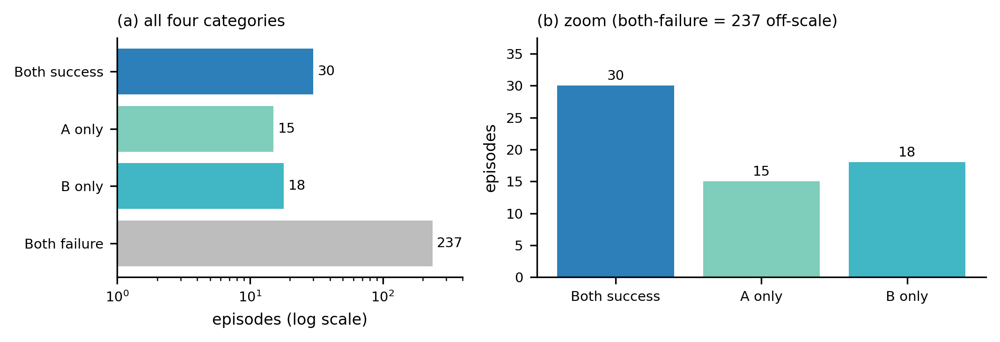

# K1 NaVILA — vision-language navigation on a Booster K1 humanoid

I ran the pretrained **NaVILA** vision-language navigation model (8B parameters) on the
**Booster K1** humanoid, evaluated it on the full VLN-CE-Isaac benchmark in simulation, and
measured how reliable that evaluation is. This repo holds the code I added, the per-episode
results, and the evidence behind each number.
Fort Lewis College, full-time research May–Aug 2026. Advisor: Dr. Yiyan Li.

## What I built

- **Two-tier stack.** NaVILA issues mid-level commands at ~1 Hz; an RL walking policy I trained
  in Isaac Sim / Isaac Lab tracks them at 50 Hz. The policy is proprioception-only ("blind"):
  a 235-dim input (5 frames × 47 joint and body signals) and 12 joint targets out. It has
  worked only in simulation.
- **K1 in VLN-CE-Isaac.** Robot, camera and gain configs, the observation bridge, the episode
  loop, an int8 VLM server, and fixes to the command parser and metrics
  (list: [`EVIDENCE.md`](EVIDENCE.md) claim 16; code: [`paper_evidence/airc2027_code/`](paper_evidence/airc2027_code/README.md)).
- **Real-robot relay.** Streams the K1's head camera to NaVILA and sends its velocity
  commands to the robot through the Booster SDK.

## Results

**Simulation benchmark (R2R val-unseen, all 1,077 episodes):** SR **18.3%** (95% Wilson CI
16.1–20.7%) · OS 30.3% · NE 7.59 m · SPL 10.9. The first full pipeline scored under 1%.
Pipeline fixes and retraining (22 training runs, ~270 GPU-hours) raised it to 18.3%. Raising an
evaluation tilt limit of ~46° that cut ~61% of early episodes short, and fixing a camera
warm-up bug, more than doubled the mean distance walked per episode
(early policy, partial runs; success rate was 0% before and after;
[`EVIDENCE.md`](EVIDENCE.md) claim 19). 18.3% is below the published blind-H1 baseline
(24.4%), which also uses a proprioception-only walking policy. Details:
[`FINAL_RESULTS_full1077.md`](FINAL_RESULTS_full1077.md).

**Evaluation reliability (2,400 preregistered ablation episodes):** two identically
configured 300-episode runs matched in aggregate (SR 15.0% vs 16.0%) but disagreed on
**11.0%** of episodes (Cohen's kappa 0.58). A fixed wall-clock limit cut off conditions
unequally (2.0% vs 12.3% of episodes). A 10-episode pilot effect did not replicate at
n = 300; the correction is kept on the record.



*Two identically configured 300-episode runs: 33 of 300 episodes succeeded in only one of them.*

**Physical robot:** in May 2026 NaVILA drove the real K1 live for two natural-language
episodes with zero teleoperation, through a laptop relay (RTX 5090 inference, ~350 ms per
inference). **Booster's built-in walker executed the commands; my trained policy was not
used.** No navigation score is claimed. One episode is on video:
[relay screen recording](https://janga786.github.io/media/k1-relay-live.mp4) ·
[third-person clip](https://janga786.github.io/media/k1-walk-to-volleyball.mp4)
(receipt: [`receipts/media/LIVE_EPISODE_RECEIPT.md`](receipts/media/LIVE_EPISODE_RECEIPT.md)).

## Limitations

- All benchmark numbers are from simulation. My trained walking policy has not yet worked
  on hardware.
- One robot, one VLM, one benchmark split. The live robot runs are n = 2, unscored, and
  tethered.
- The walking policy tends to stall when it touches a wall (it marches in place); the
  evaluator re-queries the VLM after 3 s without progress ([`EVIDENCE.md`](EVIDENCE.md) claim 20).
- The under-1% starting figure (recorded 0.76%) has no retained raw run.
- A rendering defect found after the sweep (robot geometry visible in the camera) is not
  quantified. Open issues: [`receipts/KNOWN_GAPS.md`](receipts/KNOWN_GAPS.md).

## Start here

| File | What it is |
|---|---|
| [`FINAL_RESULTS_full1077.md`](FINAL_RESULTS_full1077.md) | Full 1,077-episode results vs. the published NaVILA Go2/H1 baselines |
| [`EVIDENCE.md`](EVIDENCE.md) | Claim-by-claim verification against primary sources |
| [`receipts/KNOWN_GAPS.md`](receipts/KNOWN_GAPS.md) | Open issues and corrections, stated plainly |
| [`receipts/PRE_REGISTRATION.md`](receipts/PRE_REGISTRATION.md) | Preregistration for the 2,400-episode ablation |
| [`paper_evidence/README.md`](paper_evidence/README.md) | Reanalysis: repeatability, timeout censoring, scene uncertainty, power |
| [`ROBOT_DEPLOY_RUNBOOK.md`](ROBOT_DEPLOY_RUNBOOK.md) | How the later physical-robot deploy relay is wired and run |
| [`checkpoints/`](checkpoints/README.md) | Final walking-policy checkpoints (`.pt`, TorchScript, ONNX) |

## How to verify

The headline metrics and the reliability analysis recompute on a CPU in seconds from the
committed per-episode records, with no simulator or GPU (the two analysis scripts rewrite their
output files in `receipts/analysis/`). Without the git-ignored episode dataset, rerunning the
robustness analysis shifts some scene-cluster intervals by up to about 0.2 points; the headline
numbers are unchanged:

```bash
python3 aggregate_k1_vision_results.py --measurements-dir receipts/baseline_full_14498 --total-episodes 1077
python3 receipts/analysis/analyze_sweep.py          # per-arm results and contrasts
python3 receipts/analysis/analyze_robustness.py     # run-to-run agreement, timeouts
```

## Layout

- `checkpoints/` — policy weights and their provenance
- `receipts/` — per-episode records, run ledgers, preregistration, analysis scripts
- `paper_evidence/` — CPU-only, deterministic reanalysis scripts, tables, figures, and the
  benchmark code used for the runs. No paper is planned; folder names such as
  `paper_evidence/airc2027_*` are historical labels kept so internal links and hashes stay valid.
- `docs/` — dated June 2026 reports (10-episode smoke test, int8 replay check)
- `scripts/` — benchmark and analysis helpers
- `archive/` — dated lab-notebook status logs, kept for the record and annotated where later
  evidence corrected an entry

## Credits and provenance

Built on [NaVILA](https://navila-bot.github.io/) and the VLN-CE-Isaac benchmark. Robot: Booster K1 EDU.
The experiment designs, decisions, and claims are mine.

## License

MIT for my own code and documents (see [`LICENSE`](LICENSE)). Third-party components (NaVILA, VLN-CE-Isaac / NaVILA-Bench, Isaac Lab, the Booster SDK) keep their own licenses; copies are in [`paper_evidence/airc2027_code/navila_bench/LICENSE`](paper_evidence/airc2027_code/navila_bench/LICENSE) and [`paper_evidence/airc2027_code/isaaclab_fork/LICENSE`](paper_evidence/airc2027_code/isaaclab_fork/LICENSE).
